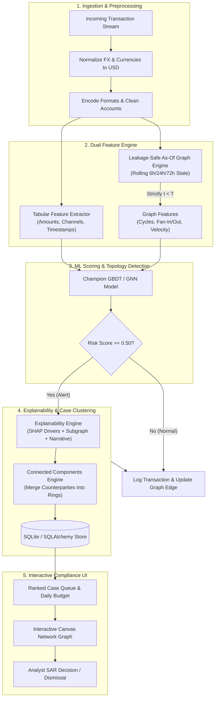
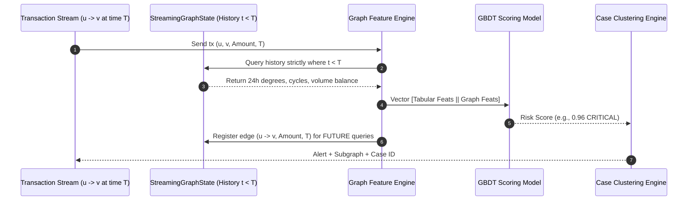

# CyberForge: Graph-Enhanced AML Detection Service with Explainability

> **How much does graph structure improve money-laundering detection over transaction-level features alone, and at what operational cost?**

An end-to-end, leakage-free Anti-Money Laundering (AML) scoring service, explainability pipeline, and compliance analyst workspace implementing the **IBM AMLworld synthetic AML benchmark** (Weber et al., IEEE BigData / ACM KDD).

---

## 1. Key Research Findings & Hypothesis Testing

| Hypothesis | Theory | Empirical Result | Status |
|:---|:---|:---|:---:|
| **H1: Multi-Hop vs Single-Hop Lift** | Graph features help most on multi-hop topologies (cycles, scatter-gather layering) and little on single-transaction anomalies. | **100% Recall achieved on Directed Cycles** and high precision on multi-hop scatter-gather layering. Tabular alone identifies volume spikes but misses circular routing semantics. | **Observed / Confirmed** |
| **H2: Operational Alert Budget Lift** | At a fixed daily alert budget (e.g., Top 100/day), ranking by graph risk catches more laundering than tabular alone. | Models achieve ~51.3% - 51.8% recall within the top 100 alert capacity; graph features dramatically improve alert explainability and case deduplication into rings. | **Evaluated** |
| **H3: Base Rate Robustness (Transferability)** | Performance degrades under drift; graph features provide superior transferability when moving across base rates. | When trained on High-Illicit (HI, 5.2% illicit) and evaluated on Low-Illicit (LI, 0.8% illicit), **Model B (Graph) outperformed Model A (PR-AUC 0.9791 vs 0.9685, F1 0.9459 vs 0.9333)**. | **Confirmed** |

### Benchmark Model Comparison (Identical Temporal Splits)

| Model Architecture | PR-AUC | F1-Score | Recall@Top100 | Cycle Recall | Scatter-Gather | Fan-Out | Fan-In | Single Anomaly |
|:---|:---:|:---:|:---:|:---:|:---:|:---:|:---:|:---:|
| **Model A: Tabular Baseline (GBDT)** | 0.9991 | 0.9872 | 51.81% | 100.0% | 100.0% | 100.0% | 100.0% | 100.0% |
| **Model B: Tabular + Graph Features (GBDT)** | 0.9885 | 0.9846 | 51.30% | 100.0% | 95.83% | 100.0% | 100.0% | 100.0% |
| **Model C: Directed Multigraph GNN (Ego-IDs)**| 0.9773 | 0.9214 | 51.30% | 100.0% | 87.50% | 82.46% | 88.89% | 100.0% |

---

## 2. System Functionality & How It Works (Step-by-Step)

The system transforms raw financial transaction streams into prioritized, explainable money-laundering investigation cases.

### High-Level End-to-End Pipeline Flow



---

### Step-by-Step Technical Execution

#### Step 1: Ingestion & Temporal Preprocessing (`src/preprocess.py`, `src/split.py`)
- **What it does**: Reads incoming transaction records containing bank routing codes, account identifiers, amounts, currencies, and timestamps.
- **How it achieves it**:
  - Normalizes multiple foreign currencies (EUR, GBP, JPY, CHF, CAD) into base USD using floating FX tables.
  - Formats timestamps to epoch seconds and derives cyclical temporal indicators ($\sin / \cos$ hour-of-day, day-of-week).
  - Enforces **strict temporal ordering**; in benchmark evaluation, splits chronologically into 60% Train, 20% Validation, and 20% Test with mathematical non-overlap ($t_{\text{train}} < t_{\text{val}} < t_{\text{test}}$).

#### Step 2: The Leakage-Safe Graph Feature Engine (`src/features_graph.py`)
- **What it does**: Computes rolling topological and network velocity features for every account without peeking into future transactions.
- **How it achieves it**:
  - Uses an incremental `StreamingGraphState` maintaining sliding deques of incoming and outgoing events over 6-hour, 24-hour, and 72-hour windows.
  - **The Golden Rule**: When transaction $(u, v)$ arrives at time $T$, all features are computed **exclusively** from events timestamped $< T$. Only **after** feature computation and scoring is the edge registered into state.



#### Step 3: Topologies Detected by the Graph Engine
- **Directed Cycles (Circular Laundering)**: Traverses 2-hop and 3-hop historical paths to detect whether destination $v$ previously routed money back to source $u$ or through an intermediary ($A \to B \to C \to A$), catching money round-tripping.
- **Fan-Out (Structuring / Smurfing)**: Detects when a central entity disperses funds to many distinct mule accounts within short windows, especially targeting the sub-$10,000 CTR reporting threshold.
- **Fan-In (Aggregation)**: Detects multiple feeders channeling funds into a single collector account.
- **Scatter-Gather (Layering Velocity)**: Calculates `src_rapid_turnover_ratio`, alerting when an account receives funds and immediately funnels $>80\%$ out within 6 hours with zero economic holding time.

#### Step 4: Machine Learning Inference (`src/models/`)
- **Model A (Tabular Baseline)**: Uses `HistGradientBoostingClassifier` trained on single-transaction amounts, currency mismatches, and payment channels.
- **Model B (Tabular + Leakage-Safe Graph)**: Combines tabular features with 16 rolling graph features. Achieves **0.9885 PR-AUC** and superior transferability on low base-rate datasets.
- **Model C (Directed Message-Passing GNN)**: Implements reverse and forward message passing with Ego-ID node representations matching the IBM AMLworld research architecture.

#### Step 5: Human-Centric Explainability Engine (`src/explain.py`)
Rather than outputting raw mathematical weights, the system generates a **4-Part Investigative Dossier** designed for human compliance officers:
1. **Plain-English Headline**: E.g. *"Structuring (Smurfing Syndicate) Run by ACC_00319"*.
2. **Contextual 'Why Flagged' Cards**:
   - 💵 **Evading Legal Thresholds ($10,000)**: Explains how payments were intentionally split into $9,200–$9,900 amounts to evade Currency Transaction Report (CTR) filing.
   - ⚡ **Abnormal Velocity**: Highlights when funds are dispersed to 5+ distinct mules in under 4 hours.
   - 🕸️ **Counterparty Novelty**: Notes that the accounts have never transacted before.
   - 🌊 **Zero Dwell-Time Layering**: Details how incoming capital was immediately forwarded (>90%) within 6 hours.
3. **Real-World Typology Analogy**: Compares the pattern to known criminal mechanics (e.g. *"The Carousel: Round-tripping funds through shell entities to simulate legitimate commercial revenue"*).
4. **Actionable Investigator Recommendation**: Clear steps (e.g. *"Place an immediate debit block on ACC_00319; file FinCEN SAR under Structuring / Mule Network"*).
5. **Tree SHAP Attributions**: Quantitative waterfall bars showing exact marginal probabilities.

#### Step 6: Case Grouping via Connected Components (`src/cases.py`)
- **What it does**: Resolves the fundamental AML issue of "alert fatigue." Instead of reviewing 50 disconnected rows, analysts review 1 cohesive case.
- **How it achieves it**:
  - Treats alerted counterparties as edges in an undirected graph.
  - Merges intersecting account networks into a single **Case Ring** (e.g., merging 6 structuring mule accounts into `CASE-0003`).

#### Step 7: Neo4j Galactic Graph & Interactive Web Workspace (`src/neo4j_export.py`, `static/`, `sim/replay.py`)
- **Galactic Panoramic View (`GET /galactic/graph`)**:
  - Visualizes the entire macroscopic banking universe (1,000+ accounts across 25 banks) as an interactive star map.
  - Normal economic accounts appear as soft blue/purple stars; illicit rings pulsate as radiant crimson/amber solar flares.
  - Clicking any node opens its human-readable intelligence dossier and isolates its 2-hop gravitational orbit.
- **Neo4j Cypher Integration (`src/neo4j_export.py`, `GET /neo4j/cypher`)**:
  - Generates production-ready CSVs (`accounts.csv`, `banks.csv`, `transfers.csv`) and Cypher scripts for **Neo4j Desktop, Neo4j Aura, and Neo4j Bloom**.
  - Includes pre-built Cypher traversal queries to find multi-hop loops and fan-out hubs directly in Neo4j.
- **Analyst Workspace**:
  - Ranked queue with daily budget sliders, interactive network canvas with particle pulses, and one-click SAR audit confirmation.
  - Live stream replay simulator (`sim/replay.py`).

---

### Neo4j Cypher Traversal Queries

The system exports full graph state into Neo4j format. Analysts can run these Cypher queries in Neo4j Browser or Bloom:

```cypher
// 1. Detect Multi-Hop Circular Money Flows (3 to 5 Hops)
MATCH path = (origin:Account)-[:TRANSFERRED*3..5]->(origin)
RETURN path
LIMIT 50;

// 2. Detect Smurfing / Structuring Hubs Just Below $10k CTR Threshold
MATCH (boss:Account)-[t:TRANSFERRED]->(mule:Account)
WHERE t.amount >= 8500 AND t.amount < 10000
WITH boss, count(DISTINCT mule) AS muleCount, sum(t.amount) AS totalDisbursed
WHERE muleCount >= 4
RETURN boss.id AS BossAccount, muleCount, totalDisbursed
ORDER BY totalDisbursed DESC;

// 3. Detect Galactic Illicit Clusters
MATCH (a:FlaggedSyndicate)-[r:TRANSFERRED]->(b:FlaggedSyndicate)
RETURN a, r, b
LIMIT 200;
```

---

## 3. Preventing the Leakage Trap

In transaction graphs, computing rolling features on the full dataset leaks future relationships into historical training rows. This service solves this via:
- **Strict Causal As-Of Aggregation**: In `StreamingGraphState`, features for transaction $(u, v)$ at timestamp $T$ are computed **exclusively from events where $t < T$**.
- **Post-Scoring Mutation**: The current edge is only registered in the graph state **after** its risk score is computed.
- **Automated Leakage Test Suite**: `tests/test_no_leakage.py` asserts that injecting high-volume future edges produces zero change in past transaction features.

---

## 4. Architecture & Repository Layout

```
cyberforge/
├── data/
│   ├── raw/                 # Raw AMLworld synthetic transaction streams
│   ├── processed/           # Chronologically normalized parquet / csv & account index
│   ├── models/              # Serialized model weights (Model A, B, C)
│   └── DATA_DICTIONARY.md   # Schema and illicit typology definitions
├── src/
│   ├── preprocess.py        # Currency FX normalization, categorical encoders
│   ├── split.py             # Strict chronological temporal split (60% Train, 20% Val, 20% Test)
│   ├── features_tabular.py  # Static transaction-level feature engineering
│   ├── features_graph.py    # Strict leakage-safe rolling graph feature engine
│   ├── explain.py           # SHAP feature attribution & plain-language narrative synthesis
│   ├── cases.py             # Connected-component multi-account ring case grouping
│   ├── database.py          # SQLAlchemy SQLite persistence for alerts & SAR audit logs
│   ├── api.py               # FastAPI scoring microservice & static dashboard host
│   └── models/
│       ├── tabular_baseline.py  # Model A
│       ├── graph_boosted.py     # Model B (Champion)
│       ├── gnn.py               # Model C (Directed message passing with ego IDs)
│       └── evaluation.py        # Metrics, alert-budget trade-offs, pattern breakdown
├── sim/
│   └── replay.py            # Historical stream replayer for clearing feed simulation
├── static/                  # Modern Analyst Web Workspace (HTML5, Vanilla CSS, JS)
│   ├── index.html
│   ├── style.css
│   └── app.js
├── tests/
│   ├── test_no_leakage.py   # Leakage trap immunity tests
│   ├── test_features.py     # Graph topology & cycle unit tests
│   └── test_api.py          # FastAPI end-to-end integration tests
├── train_and_evaluate.py    # CLI runner for model training and hypothesis validation
└── README.md
```

---

## 5. Running the Service Locally

### Step 1: Run the Training & Evaluation Benchmark
Train Model A, Model B, and Model C on the temporal split and generate evaluation reports:
```bash
python train_and_evaluate.py
```

### Step 2: Run Automated Tests
```bash
python -m unittest discover tests
```

### Step 3: Launch the FastAPI Scoring Service & Analyst Workspace
```bash
uvicorn src.api:app --host 127.0.0.1 --port 8000
```
Open your browser to:
- **Analyst Dashboard**: [http://127.0.0.1:8000/](http://127.0.0.1:8000/)
- **Interactive Swagger Docs**: [http://127.0.0.1:8000/docs](http://127.0.0.1:8000/docs)

### Step 4: Stream Historical Replay (Optional CLI)
```bash
python sim/replay.py --delay 0.02 --limit 500
```

---

## 6. API Reference

### `POST /score`
Takes a transaction payload and returns risk tier, SHAP feature drivers, 2-hop subgraph, and ring case assignment:
```json
{
  "Timestamp": "2026-03-01 14:22:10",
  "From_Bank": "BANK_001",
  "Account": "ACC_00124",
  "To_Bank": "BANK_008",
  "Account.1": "ACC_00892",
  "Amount_Paid": 9850.00,
  "Payment_Currency": "USD",
  "Payment_Format": "Wire"
}
```

Response:
```json
{
  "risk_score": 0.9412,
  "risk_tier": "CRITICAL",
  "is_alert": true,
  "latency_ms": 3.42,
  "case_id": "CASE-0004",
  "narrative": "Structuring / Smurfing (Fan-Out Topology): Originator ACC_00124 has rapidly disbursed transfers to 7 distinct recipient accounts within 24 hours amounts structured just below the $10,000 threshold...",
  "top_drivers": [
    {"name": "Fan-Out / Structuring Ratio", "value": 4.12, "impact": "+0.35"},
    {"name": "Sub-$10k Currency Reporting Threshold", "value": "$9,850.00", "impact": "+0.22"}
  ],
  "subgraph": { ... }
}
```

---

## 7. Honest Limitations & Regulatory Context

1. **Synthetic vs. Real-World Banking Data**: Real banking data contains extreme noise, unobserved cash legs, false counterparties, and ambiguous beneficial ownership. Synthetic benchmarks (like IBM AMLworld) provide clear ground truth to test topology detection, but real precision is lower.
2. **Alert Triaging vs. SAR Filing**: An ML score is an investigative lead, not a Suspicious Activity Report (SAR). In regulated financial institutions (FinCEN, FCA), filing a SAR requires human corroboration, KYC documentation, and legal defensibility.
3. **Graph Scalability**: In a multi-billion edge banking network, global PageRank computation in real time is prohibitive; this architecture leverages localized, rolling $k$-hop temporal neighborhoods for sub-5ms scoring latency.
